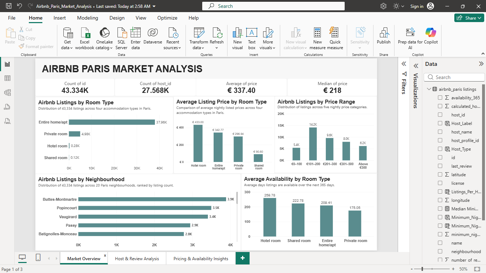
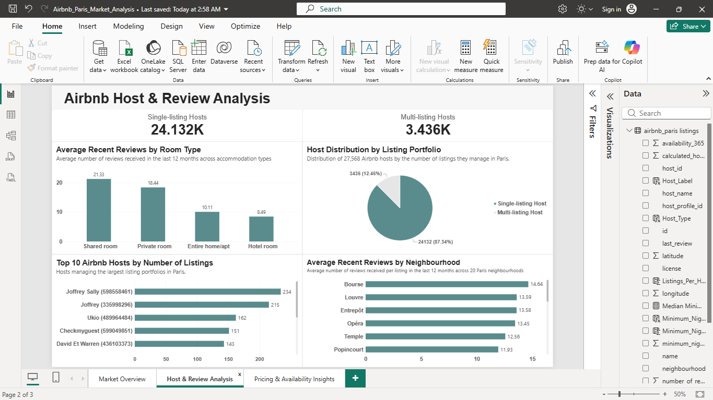
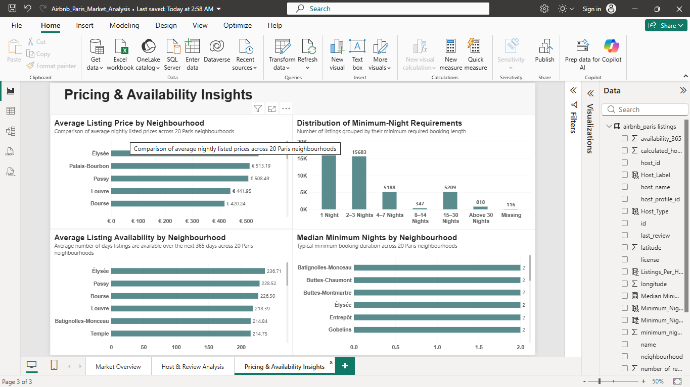

# Airbnb Paris Market Analysis

## Project Overview
This project analyses Airbnb listing data in Paris, France, to understand the city's short-term rental market. It explores listing distribution, pricing patterns, host activity, review activity, and availability.

The objective is to identify market patterns and generate insights that can support better understanding of Airbnb's listing landscape in Paris.

## Tools Used
- Microsoft Excel – Data cleaning and preparation
- MySQL – Data analysis and querying
- Power BI – Interactive dashboard and visualisation

## Dataset
- **Source:** [Inside Airbnb](https://insideairbnb.com/get-the-data/)
- **Location:** Paris, France
- **Records:** 43,334 listings
- **Data type:** Listing-level data

## Data Cleaning and Preparation

The raw Paris Airbnb listings dataset was downloaded from [Inside Airbnb](https://insideairbnb.com/get-the-data/) and cleaned using Microsoft Excel and Power Query.

### Dataset Overview

- **Final records:** 43,334 listings
- **Total columns:** 18
- **Neighbourhoods covered:** 20
- **Exact duplicate rows:** 0

### Missing Value Analysis

The following missing values were identified in the final dataset:

| Column | Missing Records | Percentage |
|---|---:|---:|
| `minimum_nights` | 116 | 0.27% |
| `last_review` | 7,393 | 17.06% |
| `reviews_per_month` | 7,393 | 17.06% |
| `license` | 5,693 | 13.14% |

### Preparation Steps

- Inspected all 18 columns for data-quality issues.
- Reviewed and corrected data types to support analysis.
- Checked for exact duplicate records.
- Identified missing values in relevant columns.
- Prepared the final dataset for MySQL analysis and Power BI visualisation.

**Data note:** Missing values were retained where filling them would require assumptions. The final dataset contains 43,334 records and was used for the subsequent analysis.

## SQL Analysis

The project uses MySQL 8.0 to analyse listing distribution, neighbourhood pricing, and host activity across Paris.

### Query 1: Neighbourhood-wise Listing Distribution

Identifies the number of Airbnb listings in each neighbourhood and calculates each neighbourhood's percentage share of the total market.

```sql
SELECT
    neighbourhood,
    COUNT(*) AS total_listings,
    ROUND(
        COUNT(*) * 100.0 / SUM(COUNT(*)) OVER (),
        2
    ) AS market_share_percentage
FROM airbnb_paris.listings
GROUP BY neighbourhood
ORDER BY total_listings DESC;
```

**Key finding:** Buttes-Montmartre has the highest listing supply, with 3,888 listings.

### Query 2: Neighbourhood-wise Pricing Analysis

Compares the average listing price and number of listings across Paris neighbourhoods.

```sql
SELECT
    neighbourhood,
    COUNT(*) AS total_listings,
    ROUND(AVG(price), 2) AS average_price
FROM airbnb_paris.listings
GROUP BY neighbourhood
ORDER BY average_price DESC;
```

**Key finding:** Élysée has the highest average listing price (€546.42), while Ménilmontant has the lowest (€198.36).

### Query 3: Top 10 Hosts by Number of Listings

Identifies the hosts managing the largest listing portfolios.

```sql
SELECT
    host_id,
    host_name,
    COUNT(*) AS total_listings
FROM airbnb_paris.listings
GROUP BY host_id, host_name
ORDER BY total_listings DESC
LIMIT 10;
```

**Key finding:** Joffrey Sally ranks first with 234 listings, followed by Joffrey with 215 listings.

These queries demonstrate the use of aggregate functions, grouping, sorting, window functions, and result limiting in SQL.

## Project Analysis

### 1. Market Overview
- Total listings and hosts
- Distribution of listings by room type
- Neighbourhood-wise listing distribution
- Average and median listing prices
- Price-range distribution
- Availability by room type

### 2. Host and Review Analysis
- Single-listing vs. multi-listing hosts
- Top 10 hosts by number of listings
- Recent review activity by room type
- Recent review activity by neighbourhood

### 3. Pricing and Availability Insights
- Average listing price by neighbourhood
- Average availability by neighbourhood
- Distribution of minimum-night requirements
- Median minimum nights by neighbourhood

## Key Findings

- The dataset contains **43,334 Airbnb listings** and **27,568 hosts**.
- Entire homes/apartments account for **37,958 listings**, making them the dominant room type.
- The average listing price is **€337.40**, while the median is **€218.00**.
- The €101–€200 price range contains the largest number of listings, with **14,157 listings**.
- **87.54% of hosts** have a single listing, while 12.46% manage multiple listings.
- Élysée has the highest average listing price among the neighbourhoods, at **€546.42**.

## Business Recommendations

Based on the analysis, the following recommendations can help stakeholders better understand the Paris Airbnb market:

1. **Evaluate neighbourhood pricing strategies:** Élysée has the highest average listing price (€546.42). Hosts and property managers should compare neighbourhood-level pricing patterns before setting their rates.

2. **Focus on the dominant accommodation segment:** Entire homes and apartments account for 37,958 listings. This segment represents the largest part of the analysed market and deserves particular attention when studying competition and pricing.

3. **Understand host portfolio distribution:** Since 87.54% of hosts manage a single listing, the market has a large proportion of individual hosts. Property managers can use this insight to distinguish individual hosting patterns from multi-listing operations.

4. **Consider minimum-night requirements:** Listing minimum-night policies vary considerably. Hosts should review their minimum-stay requirements in relation to their property type and neighbourhood.

These recommendations are based on listing-level patterns and should be treated as strategic considerations rather than proven effects on bookings or revenue.

## Power BI Dashboard

The interactive dashboard contains three pages:
1. Market Overview
2. Host & Review Analysis
3. Pricing & Availability Insights

## Repository Structure

- `sql/` – SQL analysis scripts
- `power bi/` – Power BI dashboard
- `documentation/` – Project documentation
- `Dataset/` – Cleaned dataset
- `video/` – Dashboard walkthrough
- `screenshots/` – Dashboard screenshots

## Important Limitations

This dataset contains listing-level information, not actual booking transactions. Therefore, it cannot directly measure actual occupancy, booking revenue, profitability, or booking conversion.

Availability represents calendar availability reported in the dataset and should not be interpreted as actual occupancy.

## Conclusion

This project demonstrates an end-to-end data analysis workflow, from data preparation and SQL-based analysis to interactive dashboard development and business insight generation.
## Dashboard Preview

### 1. Market Overview


### 2. Host & Review Analysis


### 3. Pricing & Availability Insights
